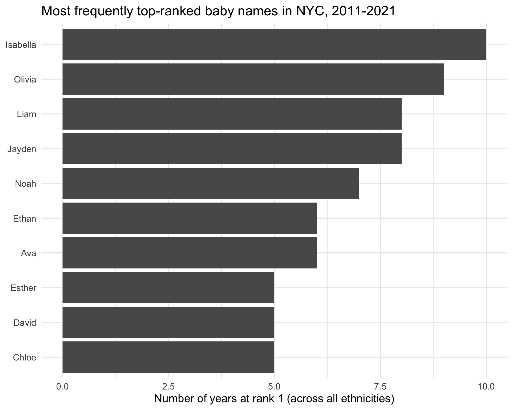

<!-- README.md is generated from README.Rmd. Please edit that file -->

# nycbabynames 

<!-- badges: start -->

<!-- badges: end -->

Provides a tibble of popular baby names by sex, ethnicity, and year of
birth in New York City, 2011–2021. Sourced from the NYC Department of
Health and Mental Hygiene via NYC Open Data.

## Installation

You can install the development version of nycbabynames like so:

``` r
remotes::install_github("kjhealy/nycbabynames")
```

## Load

``` r
library(tidyverse)
#> ── Attaching core tidyverse packages ──────────────────────── tidyverse 2.0.0 ──
#> ✔ dplyr     1.2.0     ✔ readr     2.2.0
#> ✔ forcats   1.0.1     ✔ stringr   1.6.0
#> ✔ ggplot2   4.0.2     ✔ tibble    3.3.1
#> ✔ lubridate 1.9.5     ✔ tidyr     1.3.2
#> ✔ purrr     1.2.1     
#> ── Conflicts ────────────────────────────────────────── tidyverse_conflicts() ──
#> ✖ dplyr::filter() masks stats::filter()
#> ✖ dplyr::lag()    masks stats::lag()
#> ℹ Use the conflicted package (<http://conflicted.r-lib.org/>) to force all conflicts to become errors
library(nycbabynames)
```

## What’s included

### Popular Baby Names

``` r
nyc_babynames_df
#> # A tibble: 21,612 × 6
#>    year_of_birth gender ethnicity                  childs_first_name count  rank
#>            <dbl> <chr>  <chr>                      <chr>             <dbl> <dbl>
#>  1          2021 FEMALE ASIAN AND PACIFIC ISLANDER Chloe                71     1
#>  2          2021 FEMALE ASIAN AND PACIFIC ISLANDER Olivia               71     1
#>  3          2021 FEMALE ASIAN AND PACIFIC ISLANDER Emma                 66     2
#>  4          2021 FEMALE ASIAN AND PACIFIC ISLANDER Mia                  59     3
#>  5          2021 FEMALE ASIAN AND PACIFIC ISLANDER Ava                  53     4
#>  6          2021 FEMALE ASIAN AND PACIFIC ISLANDER Amelia               46     5
#>  7          2021 FEMALE ASIAN AND PACIFIC ISLANDER Evelyn               44     6
#>  8          2021 FEMALE ASIAN AND PACIFIC ISLANDER Sophia               43     7
#>  9          2021 FEMALE ASIAN AND PACIFIC ISLANDER Aria                 42     8
#> 10          2021 FEMALE ASIAN AND PACIFIC ISLANDER Emily                39     9
#> # ℹ 21,602 more rows
```

The dataset contains 21,612 records across 11 years.

## Example

``` r
nyc_babynames_df |>
  filter(rank == 1) |>
  count(childs_first_name, gender, sort = TRUE) |>
  slice_head(n = 10) |>
  ggplot(aes(x = fct_reorder(childs_first_name, n), y = n)) +
  geom_col() +
  coord_flip() +
  labs(
    x = NULL,
    y = "Number of years at rank 1 (across all ethnicities)",
    title = "Most frequently top-ranked baby names in NYC, 2011-2021"
  ) +
  theme_minimal()
```


